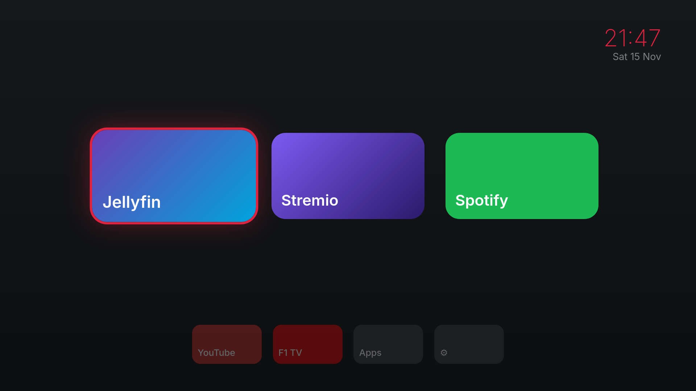

# Cherrypicked


A launcher for Android TV and Google TV, written for a TV that runs a handful of apps and an HDMI input.
The home screen is a clock and up to five favorites.

There are no ads, recommendations or accounts. The app does not request the `INTERNET` permission, so it
cannot reach the network. It is built on the Android SDK and the Kotlin standard library with no other
dependencies, and the APK is about 660 KB.

**Tested on one TV so far**, a TCL Google TV running Android 12. Other TVs and Android versions may behave
differently, most likely around the Home button, wake and HDMI inputs. If you try it on other hardware,
please [open an issue](https://github.com/chimado/cherrypicked/issues) with what worked and what didn't.



*The home screen design.*

## What it does

- Shows up to five favorites on the home screen, which can be apps or HDMI inputs. More apps are one row
  down, and the Apps tile opens the full list, sorted A–Z or by use.
- Opens a main app of your choice when the TV boots or wakes. If the TV wakes on an HDMI input, it stays
  there.
- Remaps remote buttons. Single, double and long press on a button can each open an app, switch to an
  input, act as Home or Back, open the quick panel, step the sleep timer, turn the screen off, or do nothing.
- Opens a quick panel when you hold Home, on top of whatever is playing. It has the sleep timer
  (15 to 120 minutes), the TV's inputs, screen off, and Setup.
- Lets you pick the look from 16 background patterns, 20 accent colors and 14 base colors, 6 of them light.
  The patterns are drawn in code, so there is no wallpaper image held in memory.
- Offers to add an app to favorites, or to make it the main app, once you use it a lot. Decline and it
  won't ask about that app again.
- Exports the whole setup to one JSON file and imports it back.

It needs Android 12 (API 31) or newer.

## Install

Download `cherrypicked.apk` from the [latest release](https://github.com/chimado/cherrypicked/releases/latest),
or [build it](#build), then sideload it:

```bash
adb connect <tv-ip>:5555
```

```bash
adb install -r cherrypicked.apk
```

### The Home button

Google TV has no setting for choosing a launcher, so Cherrypicked takes over the Home button with an
accessibility service. Turn it on under Settings → Accessibility → Cherrypicked.

If that switch is greyed out, set it over adb. This setting holds the whole list of enabled services, so
read the current value first and keep any entries you still want, separated by colons:

```bash
adb shell settings get secure enabled_accessibility_services
```

```bash
adb shell settings put secure enabled_accessibility_services io.github.chimado.cherrypicked/io.github.chimado.cherrypicked.a11y.CpAccessibilityService
```

TCL TVs also block the service from starting until you allow auto-start:

```bash
adb shell appops set io.github.chimado.cherrypicked APP_AUTO_START allow
```

Reinstalling with `adb install -r` can switch the service off again. When Home isn't connected, the home
screen shows a Fix Home tile that leads to these same steps.

### Optional permissions

Both are listed in Setup with their current state. Cherrypicked works without them and never prompts.

- **Display over other apps** lets the quick panel run in its own process, which exits when the panel
  closes. Without it the panel runs inside the key service and that process stays about 6 MB larger.
- **Usage access** lets the app ranking count time spent in apps you opened some other way. Without it,
  only launches from Cherrypicked count.

If the TV has no settings screen for one of them, Setup shows the adb command to use instead.

## Setup and backup

Everything is configured in Setup, which is a tile on the home screen and the last row of the quick panel.

Export writes `cherrypicked.json` to the app's external files directory, and Import reads the same file:

```bash
adb pull /sdcard/Android/data/io.github.chimado.cherrypicked/files/cherrypicked.json
```

```bash
adb push cherrypicked.json /sdcard/Android/data/io.github.chimado.cherrypicked/files/
```

Import shows a summary of what will change and asks before applying it.

## What the accessibility service sees

It receives remote key presses and the package name of the app in front. It uses them for the Home button,
the remapped buttons and the main-app check on wake. It does not read screen content, and nothing leaves
the device.

The service also has a diagnostic hook, `TestHook`, used for testing over adb. It requires the `DUMP`
permission, which only the adb shell and root hold, so other apps can't call it.

## Build

You need JDK 17 or newer and the Android SDK with platform 36. `ANDROID_HOME` defaults to `~/Android/Sdk`.

```bash
./build.sh
```

The APK is written to `dist/cherrypicked.apk`. It is signed with your local debug key. That works for
sideloading onto your own TV, but a build from one machine can't update a build from another.

To sign with your own key instead, create `~/.config/cherrypicked-release/keystore.properties` with
`storeFile`, `storePassword`, `keyAlias` and `keyPassword`. A relative `storeFile` is read from that directory.

To run the unit tests, lint and the release build together:

```bash
scripts/ci-local.sh
```

## Performance

Measured on the TCL TV (32-bit ARM, 1.8 GB RAM) with `tools/measure.sh`:

| | |
|---|---|
| Home process, in the background | about 24 MB |
| Key service process | 6 to 13 MB |
| Home press to home screen | about 80 ms |
| Cold start | about 500 ms |
| CPU and frames while idle | none |

The full runs are in [docs/design/perf.md](docs/design/perf.md).
[docs/design/bench-results.md](docs/design/bench-results.md) has the comparison of UI toolkits that led
to plain Views.

## Repository

| Path | Contents |
|---|---|
| `app/` | The app: Kotlin and platform Views |
| `docs/design/` | Design notes and measurements from the TV |
| `tools/measure.sh` | Start-up, memory and frame-time measurements over adb |
| `scripts/ci-local.sh` | Unit tests, lint and the release build |

## License

[GPL-3.0](LICENSE). The bundled Inter font is under the
[SIL Open Font License 1.1](app/src/main/assets/Inter-OFL.txt).
